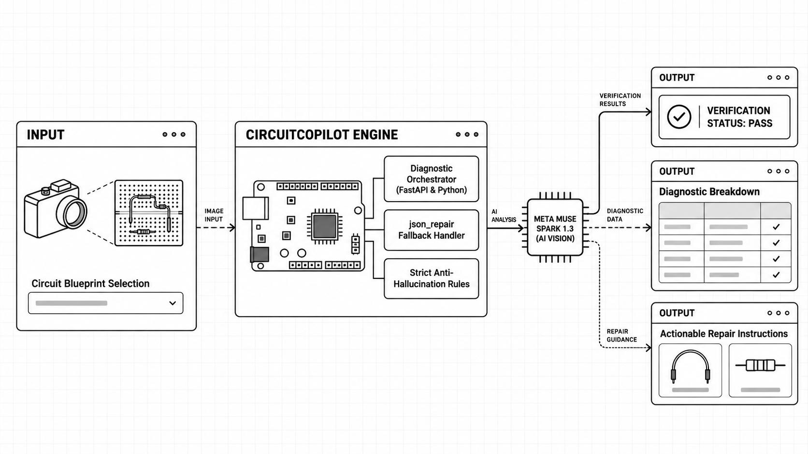

<div align="center">


# CircuitCopilot

### See the wiring. Find the fault. Fix the circuit.


</div>

CircuitCopilot is a visual diagnostic workstation for breadboard circuits. Upload a circuit image, choose a target design, and get a structured assessment of its wiring, pin paths, safety risks, and next repair steps.

## Overview

Hardware debugging often turns into a slow loop: inspect a wire, move a jumper, power up again, and hope the symptom changes. CircuitCopilot shortens that loop by comparing a circuit image with its intended design and returning an evidence-led diagnosis.

It is built for the moments when a circuit looks almost right—but one missing resistor, misplaced lead, or floating ground rail keeps it from working.

## The Architecture Advantage (Why It Wins)

CircuitCopilot analyzes the image as a whole in a single model request. FastAPI accepts the upload and selected circuit preset; the Python diagnostic engine sends the image and a focused electrical-inspection prompt to **Meta Muse Spark 1.3**. The model returns one structured JSON diagnosis covering the circuit, pin checks, annotations, safety, and remediation. The browser renders that result in the workstation UI.



That single-pass approach is deliberate. A naive per-wire pipeline would make repeated model calls, add latency with every connection, and increase the chance of timeouts or inconsistent conclusions between branches. One holistic pass gives the model the context to trace connections across the board and evaluate them against the same target specification.

The backend is **FastAPI**; the UI is a lightweight HTML workstation. Tailwind CSS is part of the requested stack, but the current page uses custom inline CSS and does not load Tailwind yet.

## Key Features

- **Visual component and grid interpretation** — identifies board components and estimates image-space annotations for the circuit and its branches.
- **Pin-trace diagnostics** — checks expected versus visible connection paths, including power and ground returns.
- **Actionable fault remediation** — reports specific wiring corrections alongside resistor checks, safety notes, and an overall PASS, WARN, or FAIL status.

## Tech Stack

- **FastAPI** — upload and health-check API
- **Python** — diagnostic orchestration and response handling
- **Meta Muse Spark 1.3** — holistic image analysis
- **Tailwind CSS** — intended utility-CSS layer; the current UI uses custom inline CSS

## Local Setup / Running

You’ll need Python 3.9+ and a `MODEL_API_KEY` with access to Meta Muse Spark 1.3.

From the repository root, create and activate a virtual environment in PowerShell:

```powershell
python -m venv .venv
.\.venv\Scripts\Activate.ps1
```

Install the runtime dependencies:

```powershell
python -m pip install fastapi uvicorn python-multipart python-dotenv openai
```

Create a `.env` file in the repository root:

```dotenv
MODEL_API_KEY=your_model_api_key
```

Start the server:

```powershell
python -m uvicorn server:app --reload --host 127.0.0.1 --port 8000
```

Open [http://127.0.0.1:8000](http://127.0.0.1:8000). The workstation is served at `/`, and `/api/health` reports service status and available circuit presets.

Keep `.env` local; never commit your API key.